# View Assist on Echo Show 8 Gen 2

### View Assist homepage — clock page


### Mediaplayer with lyrics (coming soon)


### Streaming services support


Turn an **Amazon Echo Show 8 Gen 2 (2021, Athena)** into a Home Assistant Assist
voice satellite with visual feedback from **View Assist**. It uses Amazon's
wake-word engine and audio front end (AFE) for microphone processing.

The setup has three parts:

- **[Echo Dot Assist](https://github.com/Gamer92000/echo-dot-assist/tree/checkers)**
  provides the Amazon wake word, audio processing, Assist voice connection and
  Sendspin audio on the Echo Show. Install its **checkers** branch first.
- **VACAVision** provides the display companion and Home Assistant integration for
  [View Assist](https://dinki.github.io/View-Assist/).
  View Assist's development repository is [dinki/View-Assist](https://github.com/dinki/View-Assist).
  VACAVision is inspired by **MSP1974** and his
  [View Assist Companion App](https://github.com/msp1974/ViewAssistCompanionApp).
  This variant replaces the companion's microWakeWord approach with Amazon's
  wake word through Echo Dot Assist.
- **Optional streaming and example dashboards** add launchers for Netflix,
  BBC iPlayer, ITVX and Apple TV, alongside Home, clock/weather and other
  View Assist views. Apple TV opens in Silk; the other services use Android apps.
  You supply the streaming apps and sign into your own accounts.

The bundled app and Home Assistant integration appear as **VACA_Vision** in
Home Assistant. Commands and folders use `VACAV`.

## Prerequisites

- A Linux PC with physical USB access, Git, Android platform-tools (`adb`),
  Python **3.11+** and its venv package. Keep the checkout path free of spaces.
  Allow at least **8 GB** free space. The pinned Echo Dot Assist version builds
  from source, downloading an Android NDK of about **1 GB** plus build tools.
  Its installer offers to install missing tools, including `brotli`, using sudo.
- **View Assist already installed and operational in Home Assistant**, including
  its frontend resources and a working Assist pipeline. This guide adds an Echo
  Show to your existing setup.
  See [View Assist documentation](https://dinki.github.io/View-Assist/) if needed.
- Music Assistant server and its official HA integration already operational.
  This setup uses its physical Echo Show player for music and announcements.
- The dashboard card dependencies, including `custom:button-card`, from
  [the dashboard inventory](docs/DASHBOARDS.md).
- A Home Assistant administrator account for adding devices and installing dashboards.
- Your own compatible streaming APKs if you choose those services. The wizard
  asks for their folder and installs them; proprietary APKs are not bundled or
  automatically downloaded. See [tested versions](devices/APK-VERSIONS.md).

Preserve device data, recovery backups and streaming APKs before following any
upstream operation that wipes data. APK exports do not preserve account sign-ins.

## 1. Run the Echo Dot Assist installer — unlock and install

Clone this repository with its upstream installer:

```sh
git clone --recurse-submodules https://github.com/baileyboy0304/ES8_Athena.git
cd ES8_Athena
```

For an existing checkout, update its linked components before continuing:

```sh
git pull
git submodule update --init --recursive
```

Follow the **Echo Show 8 Gen 2 / Athena** instructions in
[Echo Dot Assist's checkers guide](https://github.com/Gamer92000/echo-dot-assist/tree/checkers),
including its downloads and prerequisites, then run:

```sh
./echo-dot-assist/scripts/setup.sh athena
```

**That installer handles unlocking, firmware, rooting and Echo Dot Assist
installation.** Its pinned version requires **`saiyaku-athena-v1.0.0.zip`** with
the exact checksum in its Athena guide. A newer `v1.1.x` archive is not a drop-in
replacement; do not rename it or bypass the checksum. Follow the pinned guide’s
download requirements for a device that still needs unlocking.

**Already unlocked and sitting in TWRP after our reset?** Use this command instead
of the upstream command above, after placing the guide’s `boot-root.zip` in
`echo-dot-assist/firmware/athena/`:

```sh
./echo_setup.sh
```

This checks the USB model, recovery and root ZIP checksum, asks before rooting,
then boots the rooted system and starts the unchanged upstream installer afresh.
Choose **Keep it as it is** when it detects the rooted Echo. It does not need the
unlocker ZIP in this state. An unlocked but unrooted Echo in TWRP does **not** get
that prompt from the unmodified installer’s initial Downloads step.

The companion installer checks for Athena firmware `PS75741.7080N` and stops on a
different build. After a reset, enter your Wi-Fi SSID and password when the Echo
Dot Assist installer asks. Do not complete Amazon’s touchscreen/Alexa setup.

**Does cloning fetch the latest checkers code? No.** It fetches the exact upstream
commit recorded by this repository, from the checkers branch. The branch setting
in `.gitmodules` does not make a normal clone follow the latest tip. This keeps
our checks and firewall adaptation matched to the reviewed upstream version.
Updating that revision is a maintainer task followed by compatibility checks.

**Ignore the ESPHome “Add device” instruction on Echo Dot Assist’s done-screen.**
For this combined setup, VACAVision owns the voice connection;
there should be only one voice owner for this Echo Show. Keep existing ESPHome
entries for other devices. If this Echo Show already has one, preserve its API
key/settings before removing that duplicate ownership.

Back up `echo-dot-assist/secrets/update.key`; it signs device updates. The secrets
folder also contains your Wi-Fi credentials—keep it private.

Keep automatic Echo Dot Assist updates off while using this candidate's
installed-firewall adaptation. Retain USB access for the next step.

## 2. Install VACAVision and your selected streaming apps

In HA, open **HACS → ⋮ → Custom repositories**, add
`https://github.com/baileyboy0304/VACAV` as an **Integration**, then download
**VACAVision 0.5.0 or later** and restart HA. The recursive clone also fetches the
tested VACAV app/source revision.

From this repository’s root:

```sh
./vacav_setup.sh
```

**Updating an older VACAV APK:** this build uses the Linux signing key. An older
APK signed with the previous key cannot be updated in place. The installer stops
on Android’s signature mismatch and never uninstalls it automatically. Preserve
the working installation until you can use the original signing key or deliberately
reinstall VACAV and sign into HA on the display again. Fresh installs are unaffected.

The wizard asks for the device name and Y/N for Netflix, BBC iPlayer, ITVX and
Apple TV. It derives the example dashboard names from your device name.
It installs VACAVision and the selected apps, prepares the keyboard, Home app and
permissions, and offers a reboot. It waits for Android, Wi-Fi and VACAVision to
start rather than immediately trying to connect.

When an app is missing, choose the folder containing its APK files. Keep each
service’s files in its own folder, including all matching splits. **Apple TV needs
a Silk browser APK after a clean reset**; there is no native Apple TV APK here.
See [tested APK versions](devices/APK-VERSIONS.md).

Answer **Yes** to floating controls if you want Home, Keep on and Brightness over
other apps. A single tap during recognised playback shows the controls; a double
tap can show them on sign-in/browsing screens too. Android passes these taps to
the underlying app, so a player may also seek. The popup hides after five seconds
and does not appear over VACAVision itself. The DUMP permission is used to identify
the foreground window. For ITVX, answer **Yes** to the exact Google-services-warning
helper if you want that known warning dismissed automatically; cookie choices and
account sign-in still need your input.

On the ES8, allow VACAVision’s camera and photos/media/files permission prompts.
These prompts are separate from the voice microphone supplied by Echo Dot Assist.
Select **Allow** on the touchscreen, then complete the next permission prompt.

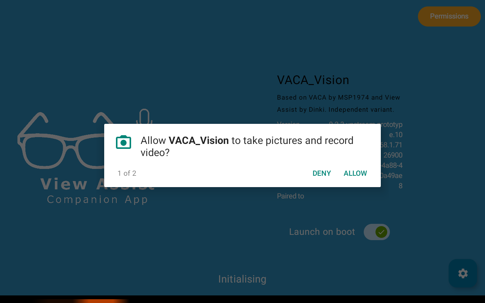

The app may show **Waiting for connection** until the next step.

VACAVision always receives TCP 80/443 web access for artwork and embedded content.
Selected streaming apps receive the same access, including advertising/telemetry;
other internet ports and UDP/QUIC remain blocked. The installer backs up and checks
the installed firewall before adapting it.

The wizard saves your device name, selected services and example dashboard names
on the Echo. Choices and USB progress are also saved in `installation-data/` on
Linux. Run the same command to resume an interrupted installation.

## 3. Add the Echo in Home Assistant

### Connect Home Assistant to VACAVision

**1. Add the discovered device.** Open **Settings → Devices & services**.
Under **Discovered**, select **Add** on the **VACA_Vision** card.


If you already have VACA_Vision devices, you can also open the integration and
select **Add** on its **Discovered** row.

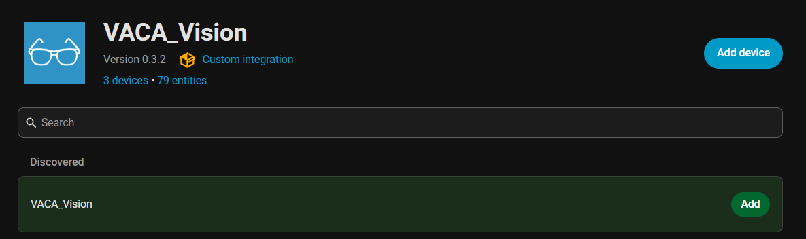

**2. Confirm the device name**, then select **Submit**. The Echo Show role and voice connection are selected automatically. VACAVision connects
the matching Music Assistant player and exposes it to Home Assistant.


<details>
<summary>If the Echo Show does not appear under Discovered</summary>

Check that VACAVision is running and HA can reach the Echo Show's IP address.
If VACA_Vision was previously ignored, show ignored integrations and stop ignoring
that discovery. Keep this Echo’s separate ESPHome discovery ignored.
Select **Add integration**, search for `VACA`, and choose **VACA_Vision**.
If you already have the integration, open it and select **Add device**.


If HA first shows **Want to add these discovered devices?**, select the discovered
**VACA_Vision** entry to use discovery. To continue with the IP-address fallback,
choose **Set up another instance of VACA_Vision**.

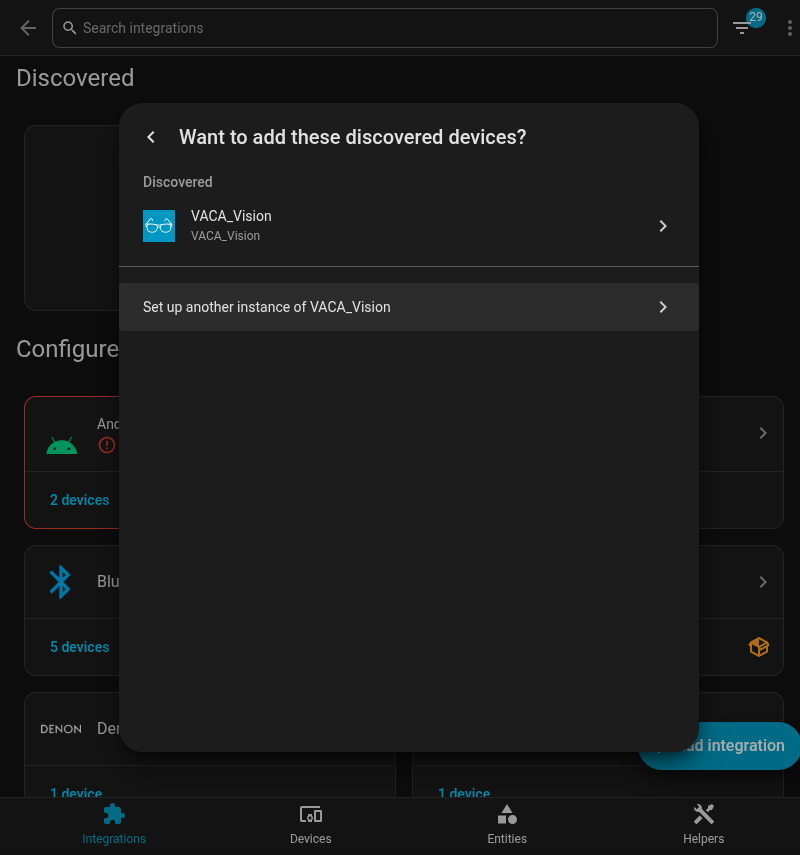

Choose **Connect an installed device by IP address**.


Enter the Echo Show's IP address shown by Echo Dot Assist and select **Submit**.
If **Vision port** is shown, leave it blank for automatic detection; only enter
a port for a custom installation. The screenshot shows the usual Echo Show port,
`26900`.


Confirm the device name and select **Submit**.

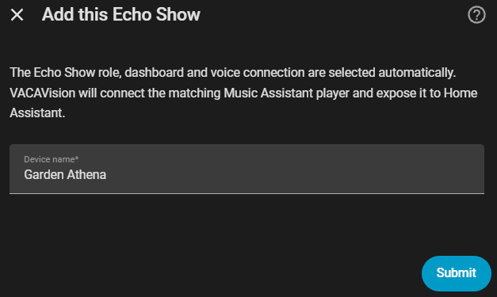

Continue with selecting the voice assistant below.

</details>

VACAVision reads the installation choices from the Echo and identifies its voice
connection and Music Assistant player. Its initial display page is HA’s built-in
dashboard. If several players match, select this Echo from the named player list.

**3. Complete HA’s voice setup.** When the **Voice Satellite setup** dialog appears,
wait for the initial connection check. If it does not open automatically, open the new VACAVision
device in HA to configure its voice assistant.

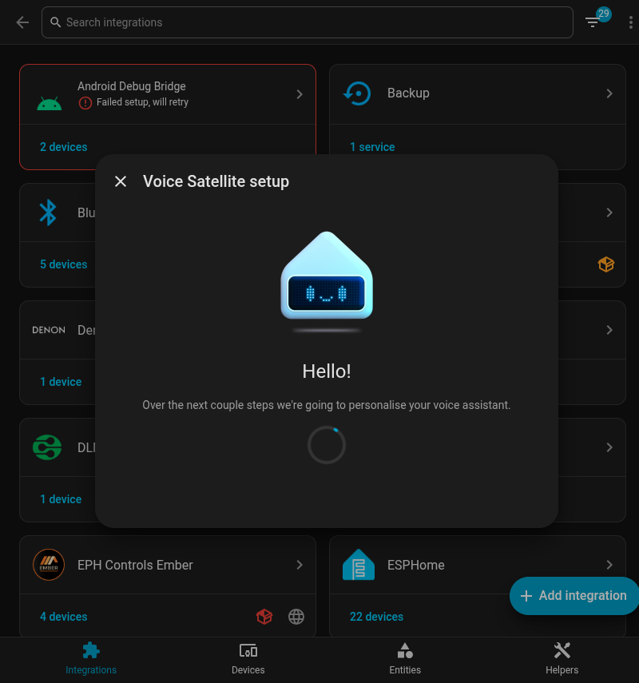

Follow the connection test; HA may ask you to say “Alexa” twice. If the first test
runs before the voice connection is ready, wait for the satellite to become
available, then retry. Select the device’s area when asked.

On **Ready to Assist!**, choose your existing Assist pipeline under **Assistant**.
Use **Try** to check the selected voice, then select **Done**. The pipeline and voice
shown below are from the walkthrough; select your own configuration.

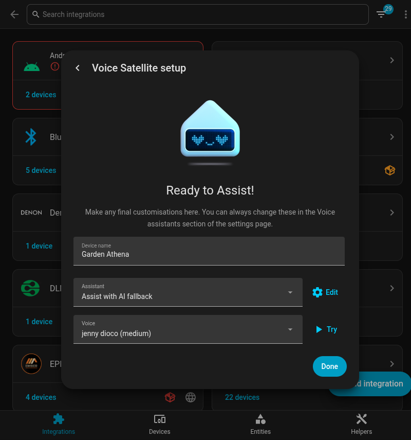

For spoken replies, HA's internal URL must be an HTTP address reachable from the
Echo Show; this version of Echo Dot Assist cannot fetch those replies over HTTPS.

### Sign into Home Assistant on the Echo Show

Now use **the Echo Show's touchscreen**. When VACAVision displays the Home
Assistant sign-in page, enter your HA username and password there. This signs
in the display's browser so it can open your dashboards. The integration
connection above does not perform this browser sign-in.

After signing in, the display opens HA’s built-in dashboard. This lets View Assist
discover the browser display ID. HA supplies the Android timezone after connection.
Existing Athena dashboards remain untouched until you approve replacement below.

## 4. Create the View Assist device

Open **Settings → Devices & services → View Assist → Add device**. Select
**View Assist device with display**, then **Next**.

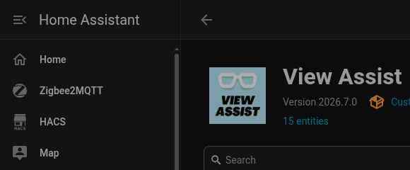

Use the name entered in the Linux installer to find this Echo’s entities. The
following example uses **Garden Athena**; substitute your own device name.

| Field | What to enter or select | Garden Athena example |
|---|---|---|
| Satellite Name | The name entered in the installer | `Garden Athena` |
| Microphone device | The Assist satellite on this VACAVision device | `assist_satellite.garden_athena_assist` |
| Media player device | This Echo’s Music Assistant player | `media_player.echo_show_8_2nd_gen_a57772` |
| Music player device | The same Music Assistant player | `media_player.echo_show_8_2nd_gen_a57772` |
| Intent Device | Leave empty for this setup | Empty |
| Orientation Sensor | Leave empty for this setup | Empty |
| Display Device | The value of this VACAVision device’s **View Assist display device** sensor | `va-vision-a2ac0a84-4a88-4a5d-ae07-de5090a49ae8` |

To find the microphone and display ID, open **VACAVision → your device** in another
HA tab. Its entities include **Assist** and **View Assist display device**. Open the
display sensor and copy its value, then select that exact value in View Assist.

Music Assistant may name the player after the hardware, such as **Echo Show 8 2nd
gen a57772**. Open its device under **Music Assistant** and check its address against
the Echo’s address. Use that player in both player fields.

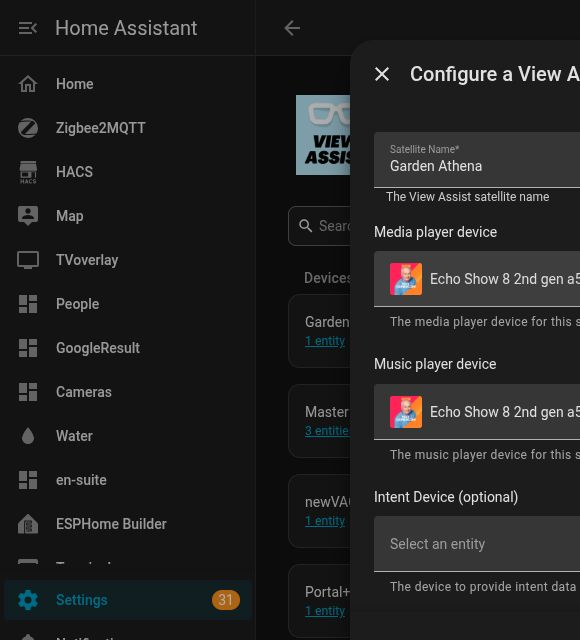

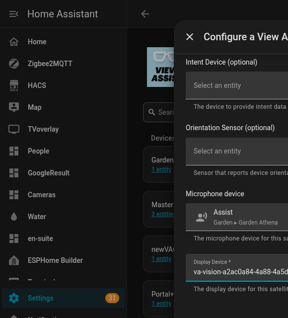

Select **Submit**. Open the new View Assist device’s **Configure** menu:

- Under **Default Options**, enable announcements and set ducking volume to **0**.
- In the same **Default Options**, use your existing View Assist weather setting, such
  as `weather.home`, or select the weather entity for this display. View Assist
  applies its master settings when the device has no override.


## 5. Install the example dashboards (optional)

Open **Settings → Devices & services → VACAVision → your device → Configure →
Install example dashboards**, then follow **Open the dashboard installer**.

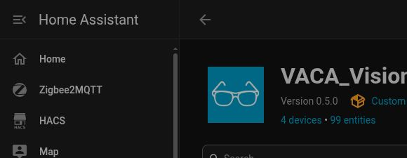

The installer reads the microphone, display, Music Assistant player and weather
from your completed View Assist setup. It detects the Music Assistant page in HA.
If that page cannot be identified, open Music Assistant and copy the URL path after
the host and port into the requested field.


Select **Install example dashboards**, review the three destination names, then
select **Back up and install**. Existing dashboard configurations are backed up in
HA before replacement. The completion screen shows the backup location and the
View Assist dashboard paths.

Open **View Assist → your device → Configure → Dashboard Options** and enter
those paths. For a new install named **Garden Athena**, they are:

| View Assist setting | Path |
|---|---|
| Dashboard | `/view-assist-garden-athena` |
| Home | `/view-assist-garden-athena/clock` |
| Music | `/view-assist-garden-athena/music` |
| Intent | `/view-assist-garden-athena/intent` |
| List | `/view-assist-garden-athena/list` |

Resumed installations retain their saved dashboard names; use the paths shown on
the completion screen. VACAV’s startup page is set to the installed Home launcher.

The integration serves the dashboard assets. Install `custom:button-card` and
the View Assist frontend before installing the example dashboards.

The Home page links to View Assist, Music Assistant in a frame with a Home button,
and TV. The TV page shows the selected services. A tap on the clock can enable VA
hold mode; tap the hand icon again to return to normal mode.

Open **Home → Music Assistant** to check the embedded player. The **Home** button
stays above the frame so you can return to the launcher.

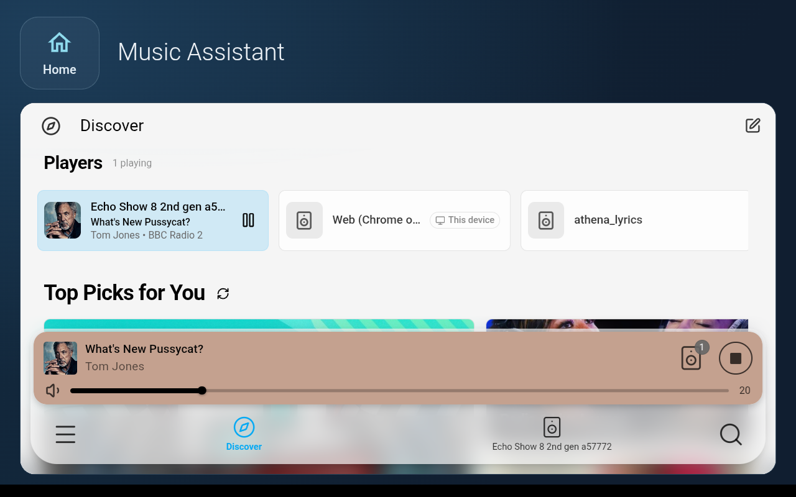

## 6. Test on the Echo Show

Ask a voice question and play music. Confirm both
come from this Echo, not another device. Sign into each streaming service, answer
ITVX’s cookie prompt, and test picture, sound, floating Home controls and mute.
A “Playing…” reply alone is not proof of audio playback. **Known issue:** ITVX live
audio can continue after returning Home. Lyrics installation is **coming soon**.

For connection checks, reopen the device’s dashboard installer and select
**Refresh connections**.
See [reruns and backups](docs/RECOVERY.md).

### Clear this device’s HA registrations as part of a clean reset

The [reset tool](reset-es8/README.md) wipes the Echo, not HA. For a clean reinstall:

- Remove only this Echo’s old **View Assist** and **VACA_Vision** entries under
  **Settings → Devices & services**. Do not remove unrelated devices.
- In **Music Assistant → Settings → Players**, remove its stale/unavailable player
  through its menu. Check any sync group that contained
  the old player and replace only that member; preserve lyrics players and other
  devices.
- Keep its ESPHome discovery ignored. VACAVision owns this Echo’s voice connection.
- Keep shared dashboards. Existing Athena dashboards can also remain: the setup
  page backs them up before an explicitly confirmed replacement.
- Update to VACAVision **0.5.0** before adding the reset Echo. Stored encryption
  keys are checked against the device during adoption.

## Project files and status

`vacav_setup.sh` is the guided entry point; `install.py` retains individual commands for
maintenance. `echo-dot-assist/` is the unchanged upstream installer; `VACAV/`
contains the app/integration; `devices/` contains the ES8 profile and dashboards.
Private inputs, generated files and backups stay in ignored `installation-data/`.

This is an installation candidate under owner review. The October walkthrough
passed voice/music, navigation and reboot after workarounds; the revised integrated
setup flow requires its own walkthrough. See
[validation](docs/VALIDATION.md), [manual checks](docs/ACCEPTANCE.md) and
[licences/attribution](docs/NOTICE.md).
