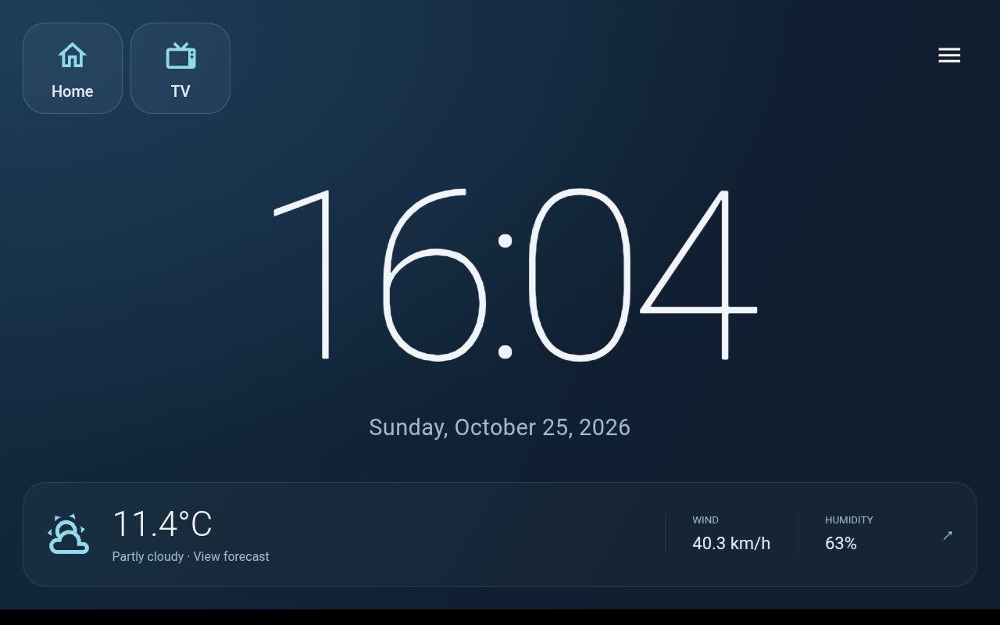
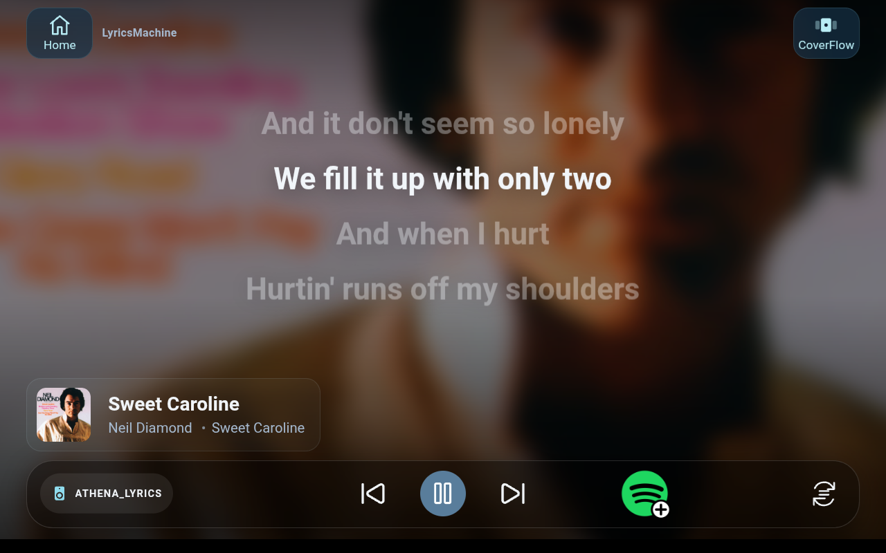
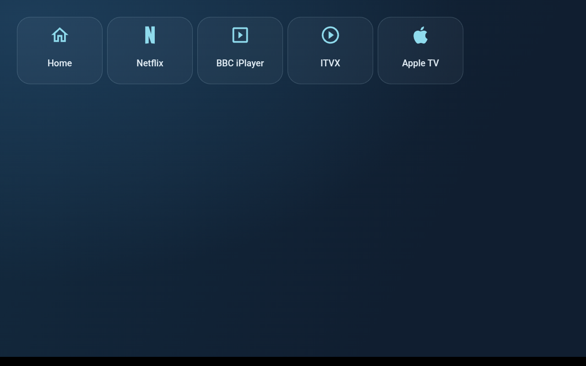
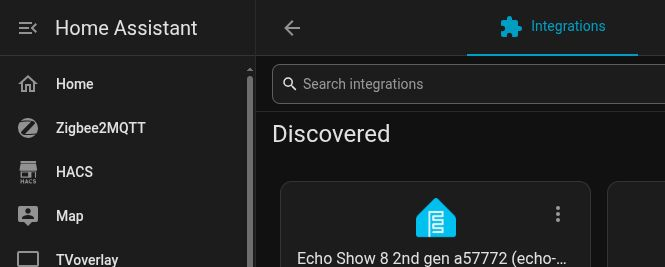

# View Assist on Echo Show 8 Gen 2

### View Assist homepage — clock page



### Mediaplayer with lyrics (coming soon)



### Streaming services support



Turn an **Amazon Echo Show 8 Gen 2 (2021, Athena)** into a Home Assistant Assist
voice satellite with visual feedback from **View Assist**. It uses Amazon's
wake-word engine and audio front end (AFE) for microphone processing.

The setup has three parts:

- **[Echo Dot Assist](https://github.com/Gamer92000/echo-dot-assist/tree/checkers)**
  provides the Amazon wake word, audio processing, Assist voice connection and
  Sendspin audio on the Echo Show. Install its **checkers** branch first.
- **VACAVision** provides the display companion and Home Assistant integration for
  [View Assist](https://dinki.github.io/View-Assist/).
  View Assist's development repository is [dinki/View-Assist](https://github.com/dinki/View-Assist).
  VACAVision is inspired by **MSP1974** and his
  [View Assist Companion App](https://github.com/msp1974/ViewAssistCompanionApp).
  This variant replaces the companion's microWakeWord approach with Amazon's
  wake word through Echo Dot Assist.
- **Optional streaming and example dashboards** add launchers for Netflix,
  BBC iPlayer, ITVX and Apple TV, alongside Home, clock/weather and other
  View Assist views. Apple TV opens in Silk; the other services use Android apps.
  You supply the streaming apps and sign into your own accounts.

The bundled app and Home Assistant integration appear as **VACA_Vision** in
Home Assistant. Commands and folders use `VACAV`.

## Prerequisites

- A Linux PC with physical USB access, Git, Android platform-tools (`adb`),
  Python **3.11+** and its venv package. Keep the checkout path free of spaces.
- **View Assist already installed and operational in Home Assistant**, including
  its frontend resources and a working Assist pipeline. This guide adds an Echo
  Show to your existing setup.
  See [View Assist documentation](https://dinki.github.io/View-Assist/) if needed.
- Music Assistant server and its official HA integration already working if you
  want the music/announcement setup described here. The current guided flow checks
  both player mappings before installing the example dashboards.
- The dashboard card dependencies, including `custom:button-card`, from
  [the dashboard inventory](docs/DASHBOARDS.md).
- An HA administrator long-lived access token for the guided checks and dashboard
  setup. Enter it at the hidden prompt; the installer does not save it.
- Your own compatible streaming APKs if you choose those services. The wizard
  asks for their folder and installs them; proprietary APKs are not bundled or
  automatically downloaded. See [tested versions](devices/APK-VERSIONS.md).

Preserve device data, recovery backups and streaming APKs before following any
upstream operation that wipes data. APK exports do not preserve account sign-ins.

## 1. Run the Echo Dot Assist installer — unlock and install

Clone this repository with its upstream installer:

```sh
git clone --recurse-submodules https://github.com/baileyboy0304/ES8_Athena.git
cd ES8_Athena
```

For an existing checkout, update its linked components before continuing:

```sh
git pull
git submodule update --init --recursive
```

Follow the **Echo Show 8 Gen 2 / Athena** instructions in
[Echo Dot Assist's checkers guide](https://github.com/Gamer92000/echo-dot-assist/tree/checkers),
including its downloads and prerequisites, then run:

```sh
./echo-dot-assist/scripts/setup.sh athena
```

**That installer handles unlocking, firmware, rooting and Echo Dot Assist
installation.** If already unlocked, follow its detected-device prompts; there is
no separate unlock procedure here. The current companion installer checks for
Athena firmware `PS75741.7080N` and stops on a different build.

**Does cloning fetch the latest checkers code? No.** It fetches the exact upstream
commit recorded by this repository, from the checkers branch. The branch setting
in `.gitmodules` does not make a normal clone follow the latest tip. This keeps
our checks and firewall adaptation matched to the reviewed upstream version.
Updating that revision is a maintainer task followed by compatibility checks.

At the end, Echo Dot Assist shows HA and Music Assistant instructions. For this
combined setup, **leave the separate ESPHome voice-entry step to VACAVision below**;
there should be only one voice owner for this Echo Show. Keep existing ESPHome
entries for other devices. If this Echo Show already has one, preserve its API
key/settings before removing that duplicate ownership.

Echo Dot Assist installs and runs Sendspin and supplies the Music Assistant
pairing token. Pair the player in Music Assistant; VACAVision will enable its
exposure to HA. View Assist's device mappings are completed during the HA handoff.

Keep automatic Echo Dot Assist updates off while using this candidate's
installed-firewall adaptation. Retain USB access for the next step.

## 2. Start the guided VACAVision installer

First install the HA integration through **HACS → ⋮ → Custom repositories**:

1. Add `https://github.com/baileyboy0304/VACAV` with type **Integration**.
2. Find **VACAVision**, download version **0.3.1 or later** and restart HA.

[The VACAV repository](https://github.com/baileyboy0304/VACAV) contains the HACS integration. The recursive clone above also checks out its tested app/source revision in `VACAV/`.

From this repository's root, run:

```sh
./vacav_setup.sh
```

This prepares the Python environment and starts the guided setup.

The wizard:

1. Connects to HA and checks that View Assist is already operational.
2. Reuses the weather entity from an existing View Assist device and the timezone
   from HA. The HA timezone is also applied to Android.
3. Asks Y/N for Netflix, BBC iPlayer, ITVX and Apple TV. Apple TV uses Silk.
   It reuses installed apps and asks for your APK folder when selected apps are
   missing. Include all required split APKs together.
4. Asks for dashboard names and the existing Music Assistant sidebar path.
   Use unique names for each additional display. It creates missing landing pages
   so first sign-in reaches a setup page rather than a 404, leaving existing
   dashboards untouched at this stage.
5. Checks the connected USB Echo Show, reviews the changes and installs VACAVision
   and your selected apps. It prepares the keyboard, timezone, Home selection and
   display permissions, with Y/N prompts for floating streaming controls and the
   ITVX warning helper. It offers a reboot.
6. Checks the HACS integration, saves your device name and startup dashboard in HA,
   and offers to copy dashboard frontend assets through a mounted HA configuration
   folder. Otherwise it gives the asset-copy instructions.
7. **Pauses and tells you exactly what to finish in HA**, as listed below.

VACAVision always receives its required web access for artwork and embedded
content. Selected streaming apps also receive TCP 80/443 access, including any
web advertising/telemetry. Other internet ports and UDP/QUIC remain blocked.
The installer backs up and checks the installed firewall files before adapting them.

Choices and USB progress are saved under ignored `installation-data/`. If you
stop, run **the same `./vacav_setup.sh` command** and choose to resume. It rechecks USB
prerequisites and lets you retain a completed USB installation. HA credentials are
requested again, not stored. Answer No at the HA pause to finish another day.

## 3. While the installer waits: finish this device in HA

You are adding/configuring **one device in your existing View Assist setup**.
Leave the installer waiting, complete these steps, then return to it.

### Prepare the Music Assistant player

If you already paired the Echo's Sendspin player during Echo Dot Assist setup,
reuse it. Otherwise pair it in Music Assistant using the token on the Echo Dot
Assist settings page (`http://DEVICE_IP:28931/`). VACAVision finds this physical
player and enables its exposure to HA automatically.

Echo Dot Assist runs Sendspin on this ES8; VACAVision's built-in Sendspin engine
is disabled in this role.

### Connect Home Assistant to VACAVision

**1. Add the discovered device.** Open **Settings → Devices & services**.
Under **Discovered**, select **Add** on the Echo Show's **VACA_Vision** card.



<details>
<summary>If the Echo Show does not appear under Discovered</summary>

Check that VACAVision is running and HA can reach the Echo Show's IP address.
Select **Add integration**, search for `VACA`, and choose **VACA_Vision**.


Choose **Connect an installed device by IP address** and enter the IP printed by
the installer. The app port is detected automatically.

</details>

**2. Confirm the device name.** The installer has already supplied the startup
dashboard. VACAVision detects the Echo Show role, connects voice, finds the
physical Music Assistant player and sets up encryption. The installer supplies
the public Sendspin identity, so this also works with MA universal players that
do not report their IP address.

If more than one player matches, or its address is unavailable, select this Echo
Show from the named player list. If no player is available, the form tells you to
pair it in Music Assistant and retry. You do not need to find a player ID.

For a new Echo, the API encryption key is created automatically and stored
privately in HA. A known key is reused. Only an Echo secured with an unknown key
asks for that existing key, available from Echo Dot Assist's settings or original
setup records. The installer does not print keys; back up HA's configuration.

**3. Select the voice assistant.** Open the new VACAVision device in HA and choose
its Assist pipeline. For spoken replies, HA's internal URL must be an HTTP
address reachable from the Echo Show; this version of Echo Dot Assist cannot
fetch those replies over HTTPS.

### Sign into Home Assistant on the Echo Show

Now use **the Echo Show's touchscreen**. When VACAVision displays the Home
Assistant sign-in page, enter your HA username and password there. This signs
in the display's browser so it can open your dashboards. The integration
connection above does not perform this browser sign-in.

After signing in, the display should open the landing page created by the
installer. View Assist can then discover its display ID. Continue with the
View Assist device mapping below before returning to the installer to replace
the landing page with the finished dashboards.

### View Assist device mapping

Add or configure this Echo Show in View Assist using its actual new identifiers:

| Setting | Value |
|---|---|
| Display | **Value** of VACAVision's display sensor, starting `va-`; not its entity ID |
| Microphone | This VACAVision device's `assist_satellite.*` entity |
| Media player / alerts | Official MA entity for the physical Echo Show Sendspin player |
| Music player | The same official MA physical-player entity |
| Dashboard | Wizard's VA path, normally `/view-assist-athena` |
| Home/default view | Wizard's clock path, normally `/view-assist-athena/clock` |
| Weather | Set through this VA device's existing weather options |
| Use announce | Enabled for compatible announcement blueprints |
| Ducking | Start at zero; Echo Dot Assist/VACAVision handle voice/music focus |
| Display mode | Fullscreen/kiosk as appropriate; native voice indicator enabled |

If your VA version's picker excludes VACAVision, the optional helper
`python install.py create-view-assist --profile es8-gen2` uses VA's normal
configuration API. Run it in another terminal using `.venv/bin/python` instead of
`python` if your virtual environment is not activated. Then configure that VA
device's dashboard, weather and default view normally. Do not create a duplicate
if the device already exists.

Confirm that a spoken Assist request receives a reply and that music actually
plays on **this Echo Show**. A spoken “Playing…” response alone is not proof.

## 4. Return to the installer — check and install dashboards

Answer **Yes** when asked whether the HA steps are finished, then select this
Echo Show's View Assist sensor. The installer checks:

- View Assist sensor is available.
- Its microphone is an available VACAVision Assist satellite.
- The display ID and microphone belong to the same VACAVision device.
- Music and alerts use the same available official MA entity, not the VACAVision
  proxy or an MA sync-group entity.
- Its VA weather entity is available and its Home path matches the planned clock.

If a check fails, the installer explains what to correct and waits for you to
retry. It also asks you to confirm voice and music playback on the Echo Show.

Once the checks pass, the wizard reads the VA weather setting, backs up existing
dashboard configurations, lists the three targets and asks before installing them.

The resulting Home page links to View Assist, Music Assistant in a frame with a
Home button, and TV. The TV page shows only selected services. Sign into those
services on the Echo Show, then test picture, sound and the floating Home control.
**Known issue:** ITVX live audio can continue after returning Home.
Lyrics installation is **coming soon**.

For a read-only repeat of the HA checks, use `./vacav_setup.sh --check-ha`.
For recovery, see [reruns and backups](docs/RECOVERY.md). The separate
[reset tool](reset-es8/README.md) is only for an explicitly requested clean reset;
a normal install or upgrade does not require it. A clean reset also needs removal
of only this device's stale VA/VACAVision entries and invalidated MA pairing.

## Project files and status

`vacav_setup.sh` is the guided entry point; `install.py` retains individual commands for
maintenance. `echo-dot-assist/` is the unchanged upstream installer; `VACAV/`
contains the app/integration; `devices/` contains the ES8 profile and dashboards.
Private inputs, generated files and backups stay in ignored `installation-data/`.

This is an installation candidate under owner review. See
[validation](docs/VALIDATION.md), [manual checks](docs/ACCEPTANCE.md) and
[licences/attribution](docs/NOTICE.md).
